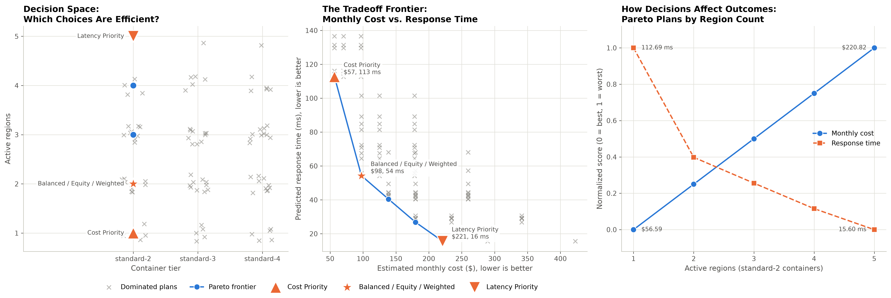

# Infrastructure Optimization Engine

## Overview
This project uses multi-objective optimization to determine the geographic placement of application workloads and the amount of computing capacity allocated to each location. It uses public data from Alibaba and RIPE Atlas to calculate the Pareto frontier between infrastructure cost and application response time.

## Business Problem
Cloudflare needs to balance the cost of maintaining its infrastructure with the performance of applications running on its network. Increasing capacity and placing applications closer to users can improve response times but also increase operating costs. This project aims to minimize both objectives while finding efficient configurations that satisfy the operational constraints.

## Status
✅ Part 1: Optimization Engine (Unit 11) - Complete \
🚧 Part 2: Decision Agent (Unit 13) - Coming soon

## Technologies
- Python
- Pandas
- NumPy
- Matplotlib
- Requests and lxml (data download)
- Jupyter Notebook

## Repository Structure
```
Infrastructure-Optimization-Engine/
├── download_data.ipynb        # Downloads and prepares the public data (run first)
├── optimization_engine.ipynb  # Pareto frontier analysis (run second)
├── data/
│   ├── DATA_SOURCE.md         # Sources, licenses and relevant variables
│   ├── original_*.csv         # Samples of the downloaded data
│   └── *.csv                  # Processed data and results
├── images/                    # Saved charts
├── requirements.txt
└── README.md
```

## Setup
1. Install Python 3.10 or newer and the required packages:

   ```bash
   pip install -r requirements.txt
   ```

2. Start Jupyter Notebook from the repository root:

   ```bash
   jupyter notebook
   ```

3. Open `download_data.ipynb` and run all cells to download and prepare the data.
4. Open `optimization_engine.ipynb` and run all cells to run the analysis.

The first notebook needs internet access and downloads about 550 MB of Alibaba archives into `data/raw/`. That folder is in `.gitignore` because the files are too large for GitHub. The processed data is already in `data/`, so you can skip step 3 and run the optimization engine directly.

## Part 1: Optimization Engine (Complete ✓)

### What It Does
This optimization engine analyzes 124 possible combinations of active regions (US East, US West, London, Singapore and Tokyo) and Cloudflare container tiers (standard-1 to standard-4) to identify the Pareto frontier of efficient solutions that balance estimated monthly infrastructure cost vs. predicted response time. Both objectives are minimized, and 93 of the combinations are feasible after checking that the container has enough memory and CPU for the workload.

### Key Findings
- 5.4% of the feasible solutions (5 of 93) are Pareto optimal, all using standard-2 containers with 1 to 5 active regions.
- 88 dominated solutions were identified and should be avoided, including every standard-3 and standard-4 plan, since a bigger container costs more without lowering the response time.
- The frontier goes from \$56.59 per month at 112.69 ms (US West only) to \$220.82 per month at 15.60 ms (all 5 regions).
- The balanced, equity and 60/40 weighted strategies all pick US East and Singapore at \$97.64 per month and 54.23 ms, which gives the biggest drop in response time for the money.



### Running the Analysis
1. Ensure you have the required packages: `pip install -r requirements.txt`
2. Run `download_data.ipynb` if you want to download fresh data (optional).
3. Open `optimization_engine.ipynb`
4. Run all cells in order
5. Outputs will be saved to the `images/` and `data/` folders

### Next Steps
Part 2 will add a constraint-aware decision agent that selects among these Pareto optimal solutions based on business constraints and priorities.

## Data Sources
See [data/DATA_SOURCE.md](data/DATA_SOURCE.md) for the Alibaba Cluster Trace, RIPE Atlas and Cloudflare Containers pricing sources.

## License
This project is licensed under the Apache License 2.0. See [LICENSE.txt](LICENSE.txt).
